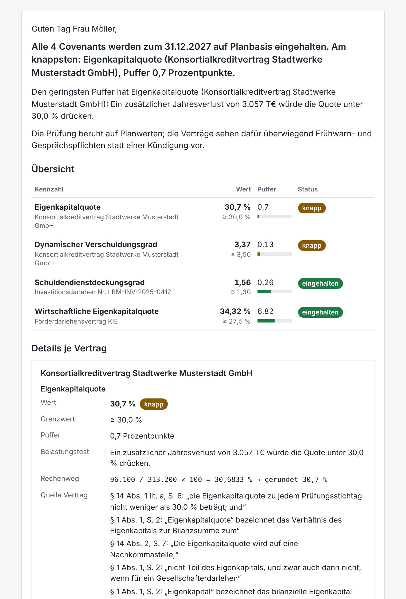

# Finn – covenant check by email

**Finn** is an email agent for a municipal utility (*Stadtwerke*). The head of finance emails Finn a
business plan (`Wirtschaftsplan_2027.xlsx`) and asks for a covenant check. Finn then:

1. reads the financial covenants from the four loan contracts,
2. takes the matching plan values from the Excel file,
3. **calculates every ratio in code**, with the headroom to its limit,
4. replies in the same email thread with a summary, a table, a stress test and the source of every number.

> **The language model reads, structures and writes. It never calculates.**
> Every number in the reply comes from Python code. Every quoted contract clause is checked
> against the PDF page it cites.

**Result for Plan 2027 (test date 31.12.2027):** all four covenants are met; the two
syndicated-loan covenants are tight.

| Contract | Covenant | Value | Limit | Headroom |
|---|---|---|---|---|
| 1 – Sparkasse, investment loan | *no financial covenants* (the preamble figures are history, not obligations) | – | – | – |
| 2 – Förderbank, promotional loan | Economic equity ratio | 34.32 % | ≥ 27.5 % | 6.82 pp |
| 3 – Landesbank, investment loan | Debt service coverage ratio | 1.56 | ≥ 1.30 | 0.26 |
| 4 – Syndicated loan | Equity ratio | 30.7 % | ≥ 30.0 % | 0.7 pp (tight) |
| 4 – Syndicated loan | Dynamic gearing (net debt / EBITDA) | 3.37 | ≤ 3.50 | 0.13 (tight) |

<p align="center"></p>

---

## Contents

- [Quick start (5 minutes)](#quick-start-5-minutes)
- [Live mode with Gmail](#live-mode-with-gmail)
- [Commands](#commands)
- [How it works](#how-it-works)
- [What the reply contains](#what-the-reply-contains)
- [Why you can trust the numbers](#why-you-can-trust-the-numbers)
- [Robustness](#robustness)
- [Configuration](#configuration)
- [Project layout](#project-layout)
- [Tests](#tests)
- [Troubleshooting](#troubleshooting)
- [Further documents](#further-documents)

---

## Quick start (5 minutes)

Requires **Python 3.11+** and an **[OpenRouter](https://openrouter.ai) API key** (a full run
costs a few cents).

```bash
git clone https://github.com/shivam952/finn-covenant-agent.git
cd finn-covenant-agent

python -m venv .venv
# Windows:      .venv\Scripts\activate
# macOS/Linux:  source .venv/bin/activate
pip install -e ".[dev]"

cp .env.example .env        # Windows: copy .env.example .env
```

Open `.env` and set **one** value: `LLM_API_KEY=` your OpenRouter key. The models are preset.

```bash
pytest -q                                                          # 112 tests, no network, ~10 s
finn run --eml data/samples/order.eml --compare-expected --preview # handle one sample order
```

The second command handles the sample order email `data/samples/order.eml` exactly as if it had
arrived in the inbox. It prints the result table, compares every number with the hand-checked
answer key (`✓` per covenant), writes the reply to `runs/<id>/reply.html` and opens it in your
browser.

It takes about **20 seconds**: the repository ships the verified contract readings in `cache/`,
so only two small LLM calls remain (reading the email, writing the summary). Delete
`cache/*.json` to make Finn read the four contracts from scratch (about 5 minutes).

---

## Live mode with Gmail

Finn works with any IMAP/SMTP mailbox. With Gmail:

1. Create a Gmail account for Finn. Don't use a personal one: Finn answers every new mail in it.
2. Turn on **2-Step Verification** (Google account → Security).
3. Create an **app password** at <https://myaccount.google.com/apppasswords> (16 letters).
4. In Gmail: Settings → *Forwarding and POP/IMAP* → **Enable IMAP**.
5. In Gmail: create a filter *To: Finn's address* → **Never send it to Spam**. A new account
   otherwise tends to file the first orders as spam, where Finn does not look.
6. In `.env`, set `MAIL_USER` and `FINN_MAIL_ADDRESS` to Finn's address and `MAIL_APP_PASSWORD`
   to the app password.
7. Run:

```bash
finn watch
```

Send an email with the plan attached to Finn's address from **any other account**. The reply
arrives in the same thread within about 30 seconds (20 s polling + about 10 s processing).
`finn watch --once` checks the inbox a single time and exits.

---

## Commands

| Command | What it does |
|---|---|
| `finn watch` | Polls the inbox every `POLL_SECONDS` (default 20) and answers every new mail exactly once, in its thread. Stop with Ctrl+C. |
| `finn watch --once` | One poll, then exit. |
| `finn run --eml FILE` | Handles one `.eml` file without a mailbox; writes `runs/<id>/reply.html`, `reply.txt`, `reply.eml` and the audit JSON. |
| `  --compare-expected` | Also compares every result with the answer key `tests/expected_2027.json`. |
| `  --lang de\|en` | Forces the reply language (otherwise the language of the email is used). |
| `  --preview` | Opens the reply in the browser. |
| `  --send` | Also sends the reply via SMTP. |
| `python -m finn.contracts.extract --compare [--no-cache]` | Reads all contracts live and compares the result with the hand-read specs (used to choose the model). |

Exit codes of `finn run`: `0` checked · `2` no check was run (e.g. missing attachment; a polite
reply was still prepared) · `1` error, or a mismatch with the answer key.

More sample emails in `data/samples/`: `order_english.eml` (English reply), `order_informal.eml`
(informal wording, one contract named as the focus), `no_attachment.eml`, `wrong_attachment.eml`,
`unrelated.eml`.

---

## How it works

A **fixed pipeline** in plain Python. There is no agent framework: the steps are always the same,
so code decides the order, and the LLM is called at **four fixed points**. Each call returns JSON
that is validated against a Pydantic schema and then checked again by code.

```
 email in ──► loop protection (code)
          ──► ① intake: LLM turns the free-text mail into an OrderIntent ──► decision (code)
          ──► read plan (code: openpyxl + formula evaluator; sheets found by role, not by name)
          ──► ② read contracts: LLM returns covenant specs (cached per contract)
                 └ code: every quote checked on its PDF page, every limit must be in its quote,
                   ratio structure checked
          ──► ③ map definitions to plan cells: LLM picks cell ids, never sees a value (cached)
                 └ code: coverage, double counting, carve-outs, no quantity left empty
          ──► calculate (code: ratio, contract-specific rounding, headroom, stress test)
          ──► ④ reply: code builds table + sources; LLM writes 2–3 summary sentences
                 └ code: every number and status word in them must belong to the named covenant
          ──► SMTP reply in the same thread + audit JSON attached
```

| Step | Where | LLM? |
|---|---|---|
| Loop protection, decision what to do | `intake.py`, `handler.py` | – |
| ① Read the email | `intake.py`, `prompts/intake.txt` | yes |
| Read the Excel plan | `plan/reader.py`, `plan/layout.py`, `plan/checks.py` | – |
| ② Read the contracts | `contracts/extract.py`, `prompts/extract_covenants.txt` | yes |
| Verify quotes on their page | `contracts/verify.py`, `contracts/pdf_text.py` | – |
| ③ Map definitions to plan cells | `mapping.py`, `prompts/map_terms.txt` | yes |
| Calculate | `calc.py` | **never** |
| ④ Summary sentences | `summary.py`, `prompts/summary.txt` | yes |
| Reply email (HTML + text) | `report.py`, `render.py`, `texts/*.toml` | – |
| Polling, exactly-once, sending | `watcher.py`, `mail/` | – |

**Why not RAG or an agent loop?** Each contract (13 pages) fits into one call, and deciding that
a contract has *no* covenants needs the whole text. An agent loop adds freedom the task doesn't
need; a fixed pipeline is easier to audit and to test.

---

## What the reply contains

- **Verdict first:** "Alle 4 Covenants werden … eingehalten. Am knappsten: …" (written by code).
- **Summary:** 2–3 sentences by the LLM, checked by code (otherwise a fixed template is used).
- **Overview table:** value, limit, headroom bar, status badge (met / tight / breached).
  "Tight" means less than 10 % relative headroom (`config/report.toml`).
- **Details per contract and covenant:**
  - the calculation (*Rechenweg*), e.g. `96.100 / 313.200 × 100 = 30,6833 % → gerundet 30,7 %`
  - the stress test: how far EBITDA may fall, or how large an extra loss may be, before the
    covenant breaks
  - the contract sources: section, page and verbatim quote
  - the plan sources: sheet, cell, row label and value
  - what the contract says about testing on plan figures (early warning vs. default)
- **Contracts without covenants**, with the reason and a quote.
- **Notes:** e.g. contract items the plan has no line for (set to 0; reasons in the audit).
- **Attachment:** the audit JSON of the run (input, extraction, cells, calculation, reply).

The reply is in the language of the email (German or English) and stays in the thread
(`In-Reply-To`, `References`, `Re:` subject, reply-all).

---

## Why you can trust the numbers

| Risk | Guard (in code) |
|---|---|
| The LLM invents or changes a number | The LLM never sees plan values. `calc.py` computes everything. |
| A wrong clause is cited | Every quote is searched on its cited PDF page (tolerant of hyphenation); a corrected page number is noted. |
| The limit comes from the wrong clause (e.g. a pricing grid) | The limit must appear in the quote of the obligation; otherwise one corrective re-read. |
| A ratio is modelled wrong | A numerator may not contain its denominator (and vice versa); otherwise one re-read, then the contract is refused. |
| A cell is counted twice | A total may not be chosen together with any cell it is built from. |
| An exclusion is subtracted twice | A carve-out ("debt, excluding shareholder loans") is only subtracted from cells that contain it. |
| A quantity silently becomes 0 | A quantity with no plan cell at all is rejected; single empty lines are shown in the reply. |
| The Excel file is inconsistent | Four reconciliation checks (balance sheet, bank debt, interest, EBITDA identity). If one fails, Finn says so and does not calculate. |
| The summary contradicts the table | Each sentence names its covenants; its numbers and status words must match them. |
| Rounding | Each contract's own rounding rule, commercial rounding with `Decimal`. |

The answer key `tests/expected_2027.json` was derived by hand from the contracts and the plan.
It also lists **trap values** that a careless reading would produce (e.g. 3.57 if the
subordinated shareholder loan is counted as debt); a test makes sure none of them appears.

---

## Robustness

- **Every email gets an answer, normally exactly one.** Missing or wrong attachment, unreadable or
  inconsistent Excel, unrelated email, unclear request and internal errors each get a short,
  polite reply. A plain "thank you" in the thread is recorded but not answered (configurable).
- **Exactly once:** handled Message-IDs are stored in `runs/processed.json`, which survives
  restarts. Finn does not rely on the unread flag, so an order someone already opened is still
  answered. A failed send is retried with the saved reply.
- **No reply loops:** Finn ignores its own replies, auto-replies, bulk mail and mailer-daemons
  (`config/agent.toml`).
- **One contract failing doesn't hide the others:** the reply says the result is incomplete.
- **Bounded LLM latency:** a time budget per call, one retry, then the fallback model.
- **Plan year:** taken from the email if the file has that column; otherwise the file decides
  and the mismatch is noted.

---

## Configuration

Secrets and machine settings live in `.env` (never committed). Everything else is in
version-controlled files, so **nothing case-specific is hardcoded in `src/`**:
`tests/test_no_hardcoding.py` fails if a year, a sheet name, a ratio name, a currency unit, a
vendor URL or a regular expression appears there.

| File | Controls |
|---|---|
| `.env` | API key, models, mailbox, polling interval, folders |
| `config/plan_layout.toml` | How sheets are recognised (by role and keywords), plan column, units, test date, the four reconciliation checks |
| `config/report.toml` | "Tight" threshold, colours, audit attachment, summary limits |
| `config/agent.toml` | Loop protection, exactly-once store, send retries, thank-you handling |
| `prompts/*.txt` | The four LLM prompts |
| `src/finn/texts/de.toml`, `en.toml` | Every sentence Finn writes, per language |

**Model:** `google/gemini-3.8-flash` (primary) via OpenRouter, `openai/gpt-5.4-mini` as fallback,
chosen by a measured comparison against hand-read specs (see NOTE.md). Any OpenAI-compatible
endpoint works (`LLM_BASE_URL`).

**Cache:** contract readings are keyed on PDF + prompt + model; mappings on the plan's
*structure*, not its values. A plan with new numbers is recalculated without new LLM calls; a
changed contract, prompt or model is re-read automatically.

---

## Project layout

```
finn-covenant-agent/
├── src/finn/
│   ├── main.py            CLI: finn run / finn watch
│   ├── handler.py         one email end to end
│   ├── intake.py          ① email → OrderIntent, decision rules, loop protection
│   ├── pipeline.py        the order of the steps (the only place that knows it)
│   ├── plan/              Excel reader, formula evaluator, layout config, reconciliation checks
│   ├── contracts/         PDF text with page markers, ② extraction, quote verification
│   ├── mapping.py         ③ definition → plan cells, with validation and carve-outs
│   ├── calc.py            all arithmetic: ratio, rounding, headroom, stress test
│   ├── summary.py         ④ summary sentences with number/status check
│   ├── report.py          reply email (HTML + text)
│   ├── render.py, fmt.py, numbers.py, notices.py, texts/   wording and number formatting
│   ├── watcher.py         polling, exactly-once store, retries
│   ├── mail/              IMAP inbox, SMTP outbox
│   ├── llm.py             OpenAI-compatible client: JSON schema, retries, fallback, time budget
│   ├── models.py          Pydantic data model
│   └── config.py, audit.py
├── prompts/               the four LLM prompts
├── config/                plan layout, report, agent settings
├── data/contracts/        the four loan contracts (PDF)
├── data/samples/          the business plan and sample emails
├── cache/                 verified contract readings and mappings (committed)
├── runs/                  one audit JSON per email (git-ignored)
├── tests/                 112 tests, answer key, golden fixtures
└── docs/                  HANDOFF.md, PROMPTS.md, images
```

---

## Tests

```bash
pytest -q
```

No network and no API key needed: a fake LLM returns hand-checked ("golden") answers. The tests
cover the plan reader and formula evaluator, the calculator against the answer key, quote
verification, every validation rule of the mapping, the summary checks, the reply email and its
MIME threading, intake decisions, the watcher's exactly-once logic, replays of the failures seen
in live runs, and the guard against hardcoding.

---

## Troubleshooting

| Symptom | Cause / fix |
|---|---|
| `finn run` takes minutes | The cache was not hit (different model or changed prompt). Expected once; later runs are fast. |
| Error about `LLM_API_KEY` | Set the key in `.env` (`OPENROUTER_API_KEY` also works). |
| IMAP login fails | Use the 16-letter app password, not the account password; IMAP must be enabled. |
| Finn never answers in live mode | Look in Finn's spam folder and add the "never spam" filter. Mail that is already read and arrived more than 15 minutes before the start is ignored on purpose. |
| The reply says the plan is inconsistent | One of the reconciliation checks failed; the reply names it. |

---

## Further documents

- **[docs/HANDOFF.md](docs/HANDOFF.md)**: the complete project handbook. Domain, every contract
  and how it is read, architecture, data model, design decisions, live-run findings, how to extend.
- **[NOTE.md](NOTE.md)**: one page with assumptions, changes to the brief, use of AI, next steps.
- **[TIMELOG.md](TIMELOG.md)**: time per step and who built it.
- **[docs/PROMPTS.md](docs/PROMPTS.md)**: every prompt given to the coding assistant, with review notes.

No keys or passwords are in this repository; `.env` is git-ignored. All business data is
synthetic (from the case study).
